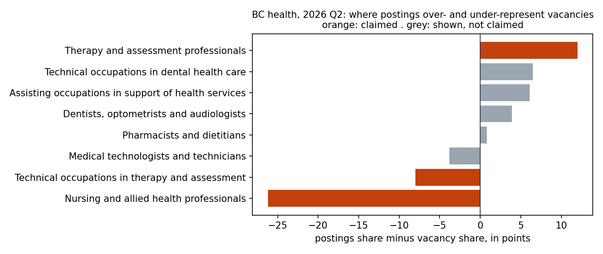

# Can a BC health-workforce planner trust job postings to tell them where demand is?

<!-- GENERATED:tldr -->
**TL;DR.** Not for every occupation. In 2026 Q2, nursing and allied health professionals held 36.2% of British Columbia's health-occupation vacancies but 10.0% of its health postings on Job Bank, a gap of -26.2 points: postings show nursing at about 28% of its share of vacancies. Therapy and assessment professionals ran the other way, at 5.5% of vacancies and 17.4% of postings. So a dashboard of postings would under-state nursing demand and over-state therapy demand. Of direct employer postings, 4.8% ask for three years of experience or more. Vacancies have ranged from 9,210 to 12,560 since 2020 Q4, with no measurable trend (a least-squares slope of -37 a quarter, standard error 26).


<!-- /GENERATED:tldr -->

## The question, and who asks it

An analytics manager at a health authority, or a provincial labour-market team, plans recruitment and training
against demand. They are offered dashboards built from job postings, and nobody tells them how far postings stand for
real vacancies. This repository answers for BC health occupations, for one named quarter, using only open data:

1. **How far postings can be trusted:** each occupation's share of Job Bank postings beside its share of Statistics
   Canada's measured vacancies.
2. **What employers ask for:** education and years of experience, by occupation.
3. **What comes next:** a four-quarter vacancy forecast, chosen by how well each model did on quarters it had not seen.
4. **How to bring in postings that carry no occupation code:** a title classifier, tested on index titles it never
   saw, against a word-overlap lookup.

The full one-page report is [report/REPORT.md](report/REPORT.md). Every number in it, and in the two marked
blocks of this README, is generated by `scripts/report.py`; none is typed.

## What it found

<!-- GENERATED:findings -->
| | finding | where it comes from |
|---|---|---|
| Trust | nursing and allied health professionals **-26.2** points; technical occupations in therapy and assessment **-8.0** points; therapy and assessment professionals **+12.0** points | `sql/20_representativeness.sql`, view `representativeness` |
| Requirements | 26 of 543 direct postings (**4.8%**) ask for three years or more; 470 (**86.6%**) ask for under two. Shares describe each group's direct postings, which differ by region from the rest of the group in 5 of 7 groups tested | `sql/35_requirements_tables.sql`, `scripts/direct_vs_external.py` |
| Forecast | No measurable trend: **-37** a quarter (standard error 26). A flat mean of the last four quarters forecast best of five models; 2026 Q3 forecast **10,262**, past forecasts within 9,115 to 11,410 four times in five | `scripts/forecast.py`, `data/forecast.csv`, `data/forecast_trend.csv` |
| Coding | Index titles never seen in training placed in the right unit group **67.0%** of the time (health **78.0%**, 123 titles), against 58.9% for a word-overlap lookup and 6.7% for the most common code | `scripts/title_classifier.py`, `data/title_classifier_eval.csv` |
<!-- /GENERATED:findings -->

## How it was built

```
fetch_sources.py   open.canada.ca and Statistics Canada -> data/raw/, sha256 of every file in data/MANIFEST.csv
build_db.py        the raw files -> SQLite; every analysis after this point is a query in sql/
forecast.py        five models, rolling-origin backtest over eight quarters, a range from the model's own errors,
                   and a least-squares slope for the trend
title_classifier   character n-grams and logistic regression; split by distinct title; scored against a lookup
direct_vs_external whether each group's direct postings differ by region from the rest of it (permutation test)
report.py          the one-page report, its three charts and this README's two marked blocks
run_all.py         all of the above in order, stopping at the first failure, with one line per run in data/runs.jsonl
```

**Every step carries a control that must fire before its result is read.** A few of them:

* the loaded postings must equal the file's data rows;
* every education and experience value in the data must sit on its ladder (0 off the ladder), and every direct
  posting in exactly one band of each (0 unbanded);
* the forecast's naive error at the last origin must equal the last quarter's change, and the slope function must
  recover a known slope;
* no title may appear in both the training and the test set (0), and a nonsense title must get a low probability.

**A gap is claimed only when it survives three ways of counting.** It must keep its sign for all postings, direct
employer postings and external postings, each at least 2 points from zero, on a vacancy estimate Statistics Canada
grades A to D. Estimates graded E are shown and never cited; suppressed ones are reported as unmeasured, never as zero.
A second AI agent, working independently of the one that built it, reviewed every part before publication and
reproduced every result; each of its findings was reproduced before it was applied. Three of the tests in this
repository are theirs: the region test, the trend slope and the lookup baseline. The rule, the floor and their
reasons are in [METHODS.md](METHODS.md).

## Run it

```
pip install -r requirements.txt
python scripts/run_all.py --fetch      # about 290 MB of open data, then every table, model, chart and the report
```

`.github/workflows/rebuild.yml` runs the same command monthly and, only when every step passes, commits the run log,
the report and this README's generated blocks, so a revision by Statistics Canada shows up as a changed line. A
failed run commits only its line in the run log.

## What is in the repository

| | |
|---|---|
| One-page report and charts | [report/](report/) |
| SQL: views, the representativeness comparison, requirements, duplicates | [sql/](sql/) |
| Scripts, each with its purpose, workflow, pitfalls and bounds at the top | [scripts/](scripts/) |
| Method, the claim rule and what it cannot carry | [METHODS.md](METHODS.md) |
| Sources, licences and vintages | [data/SOURCES.md](data/SOURCES.md), [data/MANIFEST.csv](data/MANIFEST.csv) |
| Every run, with its inputs and headline numbers | [data/runs.jsonl](data/runs.jsonl) |

## Limits

* **One quarter of postings,** 2026 Q2. Nothing here describes a trend in postings.
* **Vacancies are a stock, postings are a flow.** A gap mixes how much of an occupation's hiring reaches Job Bank with
  how long its vacancies stay open. The two cannot be separated with these data.
* **Requirements come from direct employer postings only** (counts in the report); external postings carry none, and in most
  groups the direct postings come from a different mix of regions than the rest, so the shares describe direct
  postings, not the whole group.
* **Job Bank titles are ESDC's standard titles,** so the classifier's accuracy on titles employers write themselves is
  not yet measured.
* **The forecast's range rests on five to eight past errors** per horizon and is a record of past misses, not a
  probability; the series has a break in 2020.
* Open data only: Job Bank (Open Government Licence – Canada) and Statistics Canada table 14-10-0444-01 (Statistics
  Canada Open Licence, assumed: see `data/SOURCES.md`). No posting text is reproduced and no person is named.
