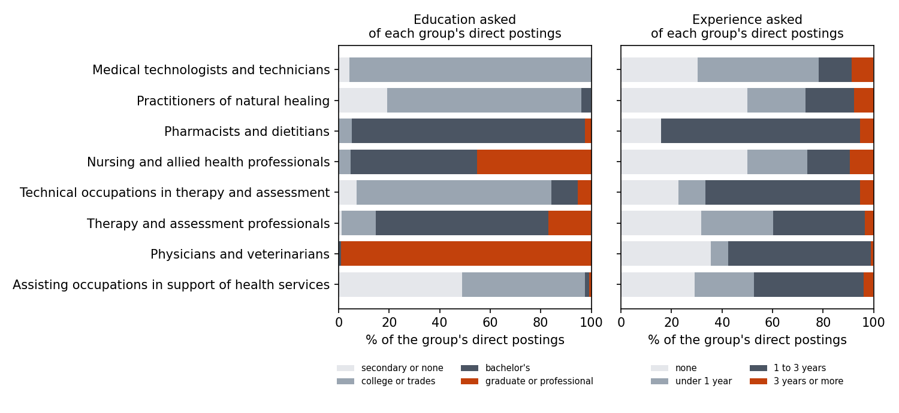
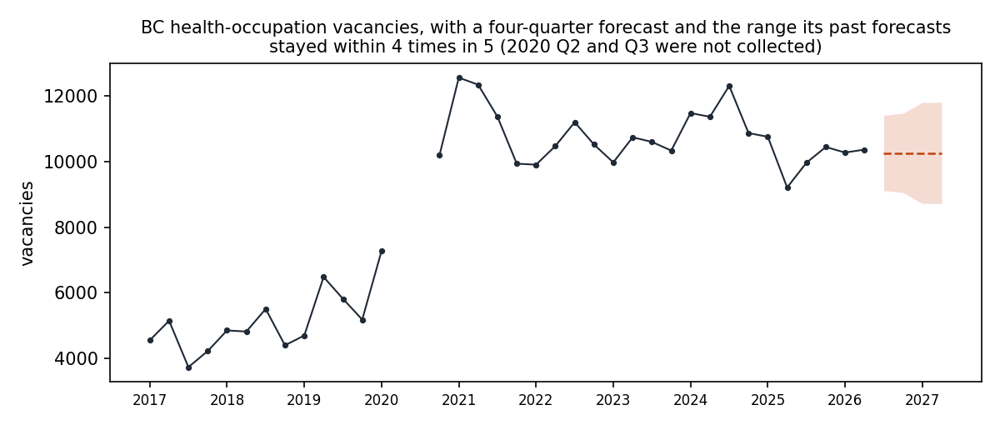

# BC health job postings: what employers ask for, and how far postings can be trusted

*Generated by `scripts/report.py` from the database and the files in `data/`. Nothing below is typed by hand.*

## The finding

**Job Bank postings are not a fair picture of where BC health vacancies are.** In 2026 Q2, nursing and allied health professionals held 36.2% of British Columbia's health-occupation vacancies but 10.0% of its health postings on Job Bank, a gap of -26.2 points: postings show nursing at about 28% of its share of vacancies.

## 1. Postings against vacancies, 2026 Q2

| occupation group (NOC 2021) | grade | vacancy share | postings share | gap (points) |
|---|---|---|---|---|
| Nursing and allied health professionals | C | 36.2% | 10.0% | -26.2 |
| Technical occupations in therapy and assessment | C | 18.1% | 10.1% | -8.0 |
| Therapy and assessment professionals | D | 5.5% | 17.4% | +12.0 |

A gap is claimed only when it keeps its sign for all, direct and external postings, each at least 2 points from zero, on a vacancy estimate graded A to D. The rule and its reasons are in `METHODS.md`.

## 2. What employers ask for, in their direct postings

From 543 direct employer postings (of 1576 in total; external postings carry no requirements). **26 of 543 (4.8%) ask for three years or more; 470 (86.6%) ask for under two.**

| occupation group | direct postings | bachelor's or higher | asks 1 year or more | direct postings differ by region from the rest of the group |
|---|---|---|---|---|
| Assisting occupations in support of health services | 127 (28% of its postings) | 2% | 47% | yes (0 of 2,000 random splits as far) |
| Physicians and veterinarians | 101 (82% of its postings) | 100% | 57% | yes (1 of 2,000 random splits as far) |
| Therapy and assessment professionals | 88 (32% of its postings) | 85% | 40% | yes (0 of 2,000 random splits as far) |
| Technical occupations in therapy and assessment | 57 (36% of its postings) | 16% | 67% | yes (1 of 2,000 random splits as far) |
| Nursing and allied health professionals | 42 (27% of its postings) | 95% | 26% | not distinguishable (148 of 2,000) |
| Pharmacists and dietitians | 38 (53% of its postings) | 95% | 84% | yes (0 of 2,000 random splits as far) |
| Practitioners of natural healing | 26 (37% of its postings) | 4% | 27% | not distinguishable (1751 of 2,000) |
| Medical technologists and technicians | 23 (60% of its postings) | 0% | 22% | not tested |

**These shares describe each group's direct postings, not the whole group.** Region is the only field both direct and external postings carry, and in 5 of the 7 groups large enough to test, the direct postings come from a different mix of regions than the rest of their group, further apart than any but a handful of 2,000 random splits of the same sizes (`scripts/direct_vs_external.py`). That shows the direct postings are not a random half; it cannot show whether their requirements differ, because external postings carry none. Groups with fewer than 20 direct postings are left out of this table; they are in `requirements_by_group`.

## 3. What comes next

Vacancies have ranged from 9,210 to 12,560 since 2020 Q4, with no measurable trend (a least-squares slope of -37 a quarter, standard error 26). Assisting occupations in support of health services are the exception: they fell from an average of 3,535 vacancies in the window's first four quarters to 2,226 in its last four (a slope of -67 a quarter, standard error 11), but show no measurable trend over the last eight quarters (-26, standard error 60), which is what the flat forecast assumes.

Five models, one of which can carry a trend, were each tested on eight past quarters they had not seen. The mean of the last four quarters made the smallest errors overall, and was best at 2 to 4 quarters ahead; at one quarter ahead, naive did better. The forecast for 2026 Q3 is 10,262. Its past forecasts at that distance stayed within 9,115 to 11,410 four times in five (from 8 past errors; a record of past misses, not a probability).

## 4. Coding postings that arrive without an occupation

Postings from other sources carry a title and no occupation code. A text classifier trained on Job Bank's coded titles placed **index titles it had never seen** in the right unit group 67.0% of the time (health occupations 78.0%, on 123 test titles). A word-overlap lookup on the same titles scores 58.9% (health 68.3%), and always guessing the most common code 6.7%, so the model adds about 8 points over a lookup (10 in health). Job Bank's titles are ESDC's standard titles, so accuracy on titles written freely by employers is not yet measured.

## Bounds

* One quarter of postings (2026 Q2). Vacancies are a stock on the first day of each month; postings are a flow. A gap mixes how much hiring reaches Job Bank with how long vacancies stay open.
* Duplicates are a bracket: 0 by posting id, 73 by title, occupation, city, date and source, of 1576 postings.
* Requirement shares describe direct postings only, which differ by region from the rest of most groups.
* The forecast's range rests on 5 to 8 past errors per horizon; the slope ignores autocorrelation, which would only widen its error.

Sources and licences: `data/SOURCES.md`. Method: `METHODS.md`.
